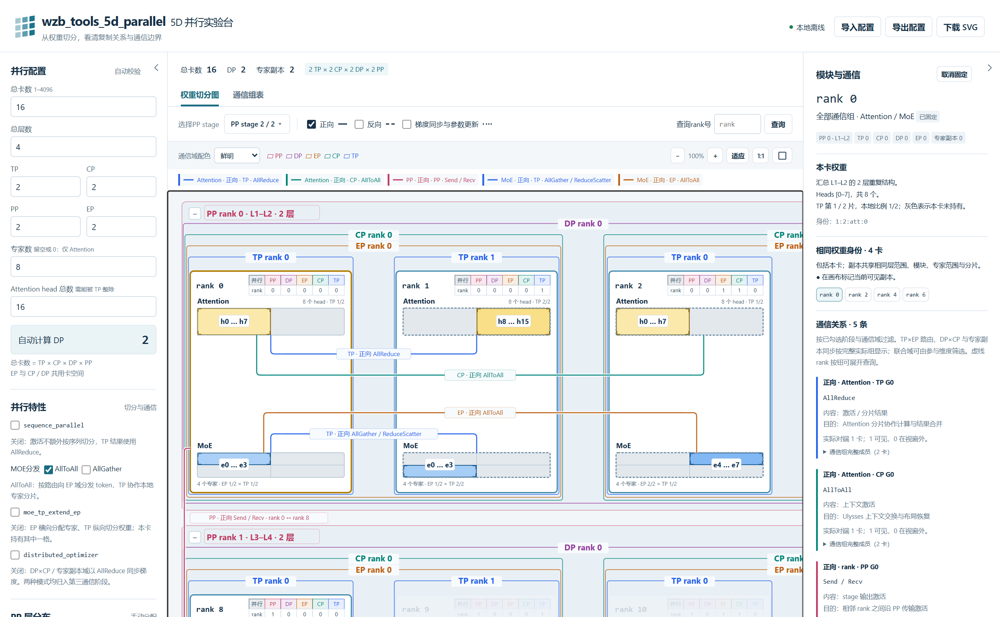

# 5D 并行可视化工具 wzb_tools_5d_parallel 功能介绍与使用指南

## 一、网站简介

wzb_tools_5d_parallel 是一个可以直接在浏览器中使用的 5D 并行可视化工具。填写并行参数后，就能查看每张卡上的 Attention、MoE 权重分布、不同卡之间的通信关系，以及 PP 流水线的调度顺序。

**在线使用：** [打开网站](https://superwzb0502.github.io/wzb_tools_5d_parallel/)

**项目源码：** [GitHub 仓库](https://github.com/SuperWZB0502/wzb_tools_5d_parallel)

## 二、网站主要功能

### 2.1 配置并行参数

可以设置总卡数、总层数、TP、CP、PP、EP，以及 Attention head 数和 MoE 专家数。DP 根据输入自动计算，配置不符合要求时会给出提示。

页面默认提供 16 卡、4 层的示例，也可以一键载入其他示例。修改总层数或 PP 后，网站会先自动分配各个 stage 的层数，也支持手动调整。

### 2.2 查看每张卡的权重分布

中间的权重切分图按 PP stage 从上到下排列，每张卡都显示完整的 rank 编号和并行坐标。

- 黄色区域表示 Attention，蓝色区域表示 MoE。
- `h` 开头的编号表示 head，`e` 开头的编号表示 expert。
- 填色区域表示当前卡持有的部分，灰色区域表示未持有的部分。

可以选择展开哪些 PP stage；大规模配置还可以通过复制块和分页切换查看。

### 2.3 查看卡片之间的通信关系

页面支持分别查看“正向”“反向”“梯度同步与参数更新”，也可以同时勾选。

鼠标移到 Attention 或 MoE 色块上，可以预览该模块的通信关系；点击整个 rank 卡片，可以同时查看该卡两类模块的通信。右侧会显示对应详情，还可以切换到“通信组表”查看组成员。

不同通信域用不同颜色区分。鼠标移到连线上的说明框，可以查看详细通信信息；单击说明框可以固定浮窗。

### 2.4 切换并行特性

左侧提供以下选项，切换后会更新相应的切分和通信展示：

- `sequence_parallel`。
- MoE 分发方式：AllToAll 或 AllGather。
- `moe_tp_extend_ep`。
- `distributed_optimizer`。

每项下方都有当前状态说明，可以直接对比开启前后的变化。

### 2.5 导入导出配置与下载图片

顶部提供“导入配置”“导出配置”和“下载 SVG”。可以保存当前配置，之后重新导入，也可以将切分图导出，用于文档、演示或分享。

### 2.6 查看 PP 流水线调度

点击“通信组表”右侧的“PP 调度图”，输入 GBS（全局批量）和 MBS（微批量）。页面会结合左侧的 DP，按 `MBN = GBS ÷（MBS × DP）` 自动算出微批次数，再根据 PP size 绘制调度图。

可以切换 1F1B 和 GPipe，也可以开启 VPP，设置每个 stage 的 chunk 数，查看交错调度。图中会考虑左侧各 stage 的层数，反向耗时默认是前向的 2 倍，可以调整。勾选分界开关，可查看各 stage 的 warmup、1F1B、cooldown 阶段。

F/B 后的数字表示微批编号，C0、C1 表示 chunk；点击色块可高亮同一微批，使用时间缩放和滚动查看大图。在该标签页点击“下载 SVG”，保存的是调度图。

GBS 必须能被 MBS × DP 整除。开启 VPP 后，MBN 还需能被 PP size 整除，每个 stage 要有足够层数分到各个 chunk。图中假设每层前向时间为 1，不计通信和重计算，用于观察调度顺序，不表示实际训练耗时。

## 三、网站使用步骤

1. **打开网站。** 先使用默认的 16 卡配置熟悉界面。
2. **修改并行参数。** 在左侧输入卡数、层数和并行参数，根据需要调整 PP 层分布。
3. **选择通信阶段。** 勾选想看的正向、反向或梯度同步与参数更新。
4. **查看卡片和模块详情。** 鼠标悬停预览，单击卡片或模块固定选择，再查看右侧详情。
5. **筛选通信域。** 点击卡片小表格中的 PP、DP、EP、CP、TP 按钮，可多选；点击“并行”恢复全选。size 为 1 的按钮不可选。
6. **保存配置或图片。** 需要保留配置时点击“导出配置”，需要图片时点击“下载 SVG”。

固定选择后，鼠标移到其他卡片不会切换详情。再次点击同一对象、点击画布空白，或点击右侧“取消固定”，即可退出选择。点击 PP、DP 等范围标识，还可以高亮该范围内的卡。

## 四、常用操作与快捷键

| 想做什么 | 怎么操作 |
| --- | --- |
| 找到某个 rank | 在“查询rank号”中输入编号，点击“查询” |
| 移动画布 | 在画布中按住 W、A、S、D，或拖动画布空白处 |
| 放大或缩小 | 使用缩放按钮，或在画布中按住 Ctrl 滚动鼠标滚轮 |
| 调整视图 | 点击“适应”或“1:1” |
| 进入全屏 | 点击“1:1”右侧的方框图标，按 Esc 退出 |
| 给画布腾出空间 | 点击左右侧栏的收起箭头 |
| 调整通信域颜色 | 在“通信域配色”中选择鲜明、色盲友好或矿物 |

## 五、离线使用方法

网站无需安装训练环境。也可以从仓库下载 `tools/draw_parallel_card.html`，用浏览器直接打开，离线使用。
